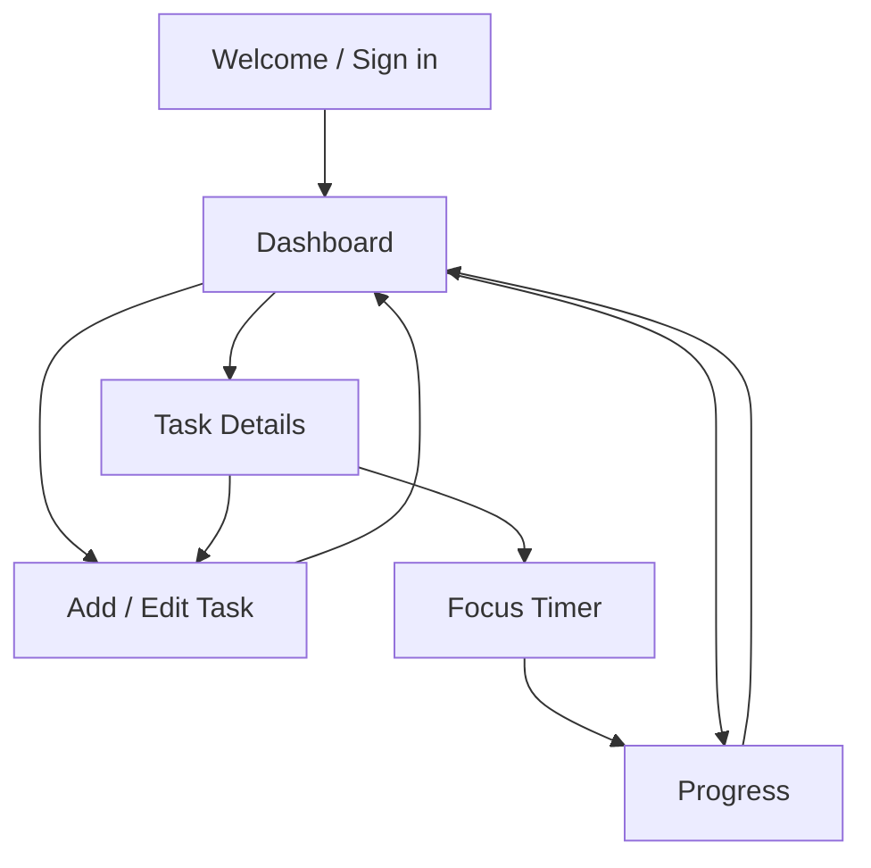

# Task 1 — App Concept and Screen Flow

## App concept

**App name:** FocusFlow  
**Category:** Student productivity / utility app  
**Platform:** Responsive web app  
**Target users:** College students who want to organize assignments, plan study time, and build consistent focus habits.

### Problem statement
Students often track assignments and deadlines in different places. This can lead to missed due dates and make it difficult to understand how consistently they study.

### Proposed solution
FocusFlow brings tasks, focus sessions, and progress tracking into one simple dashboard. A student can add a task, set its deadline and priority, start a focus timer, and review completed work.

## Main features
- Create, edit, delete, and complete study tasks.
- Set due dates and priority levels.
- Start and finish a focus session linked to a task.
- View daily and weekly productivity summaries.
- Use a clear responsive layout with accessible labels and contrast.

## Primary screens

### 1. Welcome / Sign in
**Purpose:** Introduce FocusFlow and let a student create an account or sign in.  
**Main elements:** Product name and short value statement; email and password fields; Sign in and Create account actions.  
**Primary action:** Sign in / Create account → Dashboard.

### 2. Dashboard
**Purpose:** Give a quick overview of today's work.  
**Main elements:** Today's tasks, task status summary, upcoming deadlines, and quick actions for Add Task, Start Focus, and View Progress.  
**Primary action:** Add Task → Add / Edit Task; select a task → Task Details.

### 3. Add / Edit Task
**Purpose:** Create or update a study task.  
**Main elements:** Title, optional description, due date, priority, status, Save, and Cancel.  
**Primary action:** Save → Dashboard (task appears in the list).

### 4. Task Details
**Purpose:** Review one task and choose what to do next.  
**Main elements:** Task title and description, deadline, priority, status, Edit, Delete, and Start Focus.  
**Primary action:** Start Focus → Focus Timer; Edit → Add / Edit Task.

### 5. Focus Timer
**Purpose:** Help the student complete a focused study session.  
**Main elements:** Selected task, countdown, Start, Pause, Resume, and Finish controls.  
**Primary action:** Finish → save session → Progress or Dashboard.

### 6. Progress
**Purpose:** Show the student's study activity and consistency.  
**Main elements:** Tasks completed today, total focus minutes, and a weekly summary.  
**Primary action:** Dashboard link → Dashboard.

## Navigation flow

### Navigation notes
- The Dashboard is the central screen after authentication.
- Users can reach Add / Edit Task from the Dashboard or Task Details.
- Focus Timer starts from a selected task.
- Completing a focus session updates Progress.
- A persistent navigation area should provide Dashboard and Progress access.

## Accessibility and visual design
- Use a consistent, uncluttered layout and predictable navigation.
- Use semantic headings and descriptive labels for every form control.
- Ensure text and controls have sufficient contrast.
- Do not communicate priority or completion using color alone; include text or icons with accessible names.
- Support keyboard navigation and visible focus states.
- Use readable text sizes and responsive layouts for mobile and desktop.
- Provide clear validation messages and confirmation for destructive actions.

## Suggested visual direction
- **Primary color:** Blue
- **Background:** White or very light gray
- **Typography:** Inter or a system sans-serif
- **Style:** Minimal, calm, student-friendly
- **Components:** Task cards, priority labels, progress summary, and a simple bottom or side navigation

## Deliverable
This document defines the app concept, target users, six primary screens, accessibility considerations, and the navigation flow for Task 1. Screen mockups can be created from these descriptions in Figma or as wireframes.

## Repository
[Full-Stack Developer Internship repository](https://github.com/sandeep6386510-ship-it/Full-Stack-Developer-Internship)
